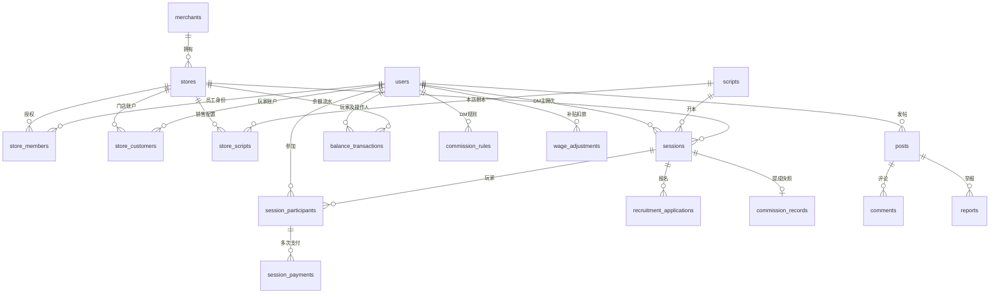

# 数据关系与统计口径

来源：`js/demo-data.js`、`js/domain.js`、`js/store.js`、`js/finance.js`、`database/schema.sql`。本地以同名集合模拟业务表，云端使用 PostgreSQL 表与事务 RPC。本轮沿用 `api.load / api.command` 的统一适配器，保留业务模型，不为生产构建重复建立数据服务。

## 关系图



`store_scripts.dm_ids` 保存可开 DM 的业务用户 ID 数组；业务命令校验其门店员工资格。收藏同时支持帖子与剧本，云端使用目标类型及相应外键约束。审计记录关联操作人和对象，财务历史外键以限制删除为主。

## 表与集合

| 表 / 集合 | 用途与关键字段 |
| --- | --- |
| `users` | 业务用户；昵称、城市、虚构联系方式、简介。云端 `auth_id` 唯一绑定 `auth.users.id`，`is_platform` 仅由受信任管理环境设置 |
| `merchants` | 品牌、服务状态、订阅到期日 |
| `stores` | 品牌所属门店、城市、介绍、地址、营业时间、环境和房间 |
| `store_members` | 用户与门店的 admin / dm 角色及启用状态；不等于玩家会员 |
| `store_customers` | 玩家 × 门店唯一账户；会员、到期日、余额缓存 |
| `scripts` | 唯一公共剧本资料；人数、配置、时长、类型、难度、发行方、简介 |
| `store_scripts` | 门店 × 剧本配置；价格、可开 DM、展示、新本 |
| `sessions` | 门店、剧本、DM、日期时间、人数、价格、类型、状态及作废原因 |
| `session_participants` | 场次 × 玩家唯一记录；应收、消费、优惠、原因 |
| `session_payments` | 一个场次玩家的多条支付；方式和金额；必须归属同一个场次 |
| `recruitment_applications` | 报名人、联系方式、备注、pending / confirmed / rejected |
| `balance_transactions` | 余额变动、操作前后余额、类型、支付方式、原因、场次及操作人 |
| `commission_rules` | 门店 × DM 当前规则；模板、金额、比例、阈值、超员奖励 |
| `commission_records` | 每场一个提成记录；金额、完整规则快照、作废标记 |
| `wage_adjustments` | 月份、DM、补贴或扣款、金额、原因、操作人 |
| `audit_logs` | 操作人、门店、动作、对象类型与 ID、前后数据及时间 |
| `posts` | 作者、门店、类型、标题、正文、下架状态 |
| `comments` | 帖子、作者、正文、官方回复标志 |
| `favorites` | 用户 × 目标唯一收藏，目标为帖子或剧本 |
| `likes` | 用户 × 帖子唯一点赞 |
| `reports` | 举报人、帖子、原因、待处理 / 下架 / 驳回状态 |

所有云端业务表有主键及 `created_at`；可变资料包含必要的 `updated_at`。财务记录不依赖用户硬删除级联清除；Auth 用户解绑不抹掉业务财务用户。

## 金额与账户

金额字段为整数分；云端使用 bigint。页面金额允许至两位小数，转为整数后校验。单笔和账户余额按代码的上限校验，不允许负余额。

`balance_transactions.after_balance = before_balance + delta`。充值、赠送、退款增加余额；消费减少余额；后台修正明确方向且必须填写原因。不能直接输入目标余额。`store_customers.balance` 是与流水同步维护的当前值，不替代流水审计。

提成 `rate` 为万分比，1000 表示 10%。固定每场取 amount，按人头取 amount × 人数，百分比取实际消费 × rate / 10000 并向下取整，超员规则取基础 amount + max(0, 人数 - threshold) × extra。

## 场次状态与原子操作

```text
草稿 → 已确认 / 拼场中 → 已完成 → 已作废
草稿 / 已确认 / 拼场中 → 已取消
草稿且无财务记录 → 允许删除
```

状态对应 `draft / confirmed / recruiting / completed / voided / cancelled`。创建普通场次发布为 confirmed，拼场发布为 recruiting。只有开放中的有效场次可结算；报名未确认不计入已上车人数。

结算校验全部参与玩家，消费与优惠之和等于应收，支付之和等于消费。校验通过后同笔操作保存支付、扣余额及流水、提成快照、完成状态及审计。重复结算拒绝。

本地 `DemoStore.command` 在独立副本中操作，全部成功后一次写入；多标签页使用锁及版本冲突检查。云端 `demo_command` 以一次数据库函数调用完成事务，涉及余额、场次等记录时加锁；异常由 PostgreSQL 回滚。事务设计与实际数据库验证结果需区分，云端执行证据另行记录。

作废仅限已完成场次且必须有原因。原消费与支付保留，原余额扣款生成反向退款流水，提成标记 voided，场次状态 voided，不再计入有效收入、有效人次与提成。非余额支付退款只提供记录和线下处理提示。

## 统计口径

| 指标 | 计算 |
| --- | --- |
| 有效完成场次 | status = completed，按门店、场次日期、DM、剧本筛选 |
| 玩家人次 | 有效场次中的参与记录数，不去重用户 |
| 应收 / 实际消费 / 优惠 | 分别汇总有效参与记录 due / actual / discount |
| 各方式收款 | 汇总有效场次 session_payments 中对应方式的金额 |
| 余额充值收款 | 单独汇总 recharge 流水 delta，按流水操作日期；不与消费收入相加 |
| 支付方式筛选 | 选择包含该方式的完整场次；另列所选方式实际收款 |
| DM有效场次和提成 | 按场次日期月份，completed 场次且记录未作废，读取已保存快照金额 |
| 预计应发 | 历史场次提成 + 当月补贴 - 当月扣款 |
| 拼场当前人数 | 已加入 session_participants 的人数；pending 报名不计入 |

初始张三余额 37200、小王历史提成 186000 均从真实种子记录构成，不是仪表盘展示常量。规则变更不重算历史快照。

## 权限边界

| 身份 | 私人数据与操作 |
| --- | --- |
| 玩家 | 自己的账户、流水、消费、报名和收藏；公开目录及社区可见 |
| DM | 该 DM 在授权门店的场次及提成；不能改会员余额或读其他 DM 工资 |
| 门店管理员 | 被授权门店业务；不可越店修改 |
| 平台管理员 | 平台范围；订阅和举报处理 |

云端 RPC 用 `auth.uid()` → `users.auth_id` 识别用户，服务器校验请求的 role 与 store。`demo_read` 返回 available_contexts，包含当前业务用户实际可选的角色和门店；玩家、平台角色不固定绑定门店。所有表启用 RLS；anon / authenticated 的直接表读写权限受限，业务通过 `demo_read`、`demo_command` 暴露。security definer 函数必须保持内部鉴权和受限执行权限，不可移除校验以解决登录问题。

公开目录返回昵称和介绍等资料；联系方式、玩家账户和工资数据按权限过滤。浏览器不能自授 `auth_id`、平台身份或门店角色。本地不具备远程服务器提供的可信身份边界。

## 持久化与种子

本地键为 `script-store-demo-v1`，同一设备、浏览器和 origin 内多演示角色共享一份本地业务数据库；身份及当前页面另存 sessionStorage，刷新后恢复。不同设备、浏览器、主机名、端口、HTTP/HTTPS 对应独立数据，不因为公开网址相同就同步。重置仅本地模式提供，替换整份演示数据并重新生成日期。

云端各设备使用相同 Supabase 项目，按真实 Auth 账号权限读写服务器数据库；没有配置云端时属于 DEMO ONLY。配置来自`VITE_SUPABASE_URL`、`VITE_SUPABASE_PUBLISHABLE_KEY`；浏览器仅接受公开Publishable Key，旧名称别名不绕过key类型校验。Pages工作流从仓库Actions Variables读取两项公开值，Vite在构建时写入客户端资源，变量变化后须重新运行工作流部署。

云端种子由 `tools/seed.js` 写为 `database/seed.sql`，按顺序插入依赖表，主键冲突跳过，不覆盖现有记录。

初始历史场次是虚构月度样本，保持小王18场及1860元示例；相同 DM 不重复同日期、同开始时间，但不代表完整真实时长排班。新录入和编辑场次需通过日期时间、剧本开本权限及时间冲突校验。

导出为当前角色可见 JSON，不是完整平台备份。缺少导入恢复入口；私有导出和真实账号资料不应进入公共代码交付。

## 查询投影与实测

`participant_counts` 返回当前身份可见场次的总人数，玩家历史列表不因其他玩家身份被隐藏而误显示为 1 人；`dm_counts` 是公开累计有效主持场次，不含提成或工资数据。充值日期筛选统一按 Asia/Shanghai，避免 UTC 午夜造成日期错位。云端读取仅返回获授角色与门店上下文；未完成场次编辑不发送空状态字段。

本地实测消费：应收 38400 分、实际消费 25600 分、优惠 12800 分；余额 10000 分、微信 2800 分、现金 12800 分。作废生成余额 +10000 分冲正，原支付与消费保留但退出营业额和有效提成统计；50000 分充值继续独立计入资金流入。SQL仅静态审查，真实数据库事务与 RLS 未实机执行。

上述消费为原本地验收记录。本轮不更改财务数据模型；共享数据库、RLS和跨设备一致性仍需在真实测试项目配置后验证，不能用手机页面预览或生产构建成功代替。

## 历史 Vite 数据链路实测（2026-10-05）

390px生产预览中两名玩家应收各12800分、实际消费合计25600分；张三余额10000分+微信2800分，玩家2现金12800分。微信少100分时结算被拒绝；双击合法结算仅提交一次。张三余额37200→27200分，营业额1689600→1715200分，有效场次22→23，小王18场/186000分→19场/196000分。

双击充值仅生成一次50000分现金充值，余额77200分；独立充值不计入场次消费。拼场确认4/6→5/6一次；当前规则改为15000分不改已保存的10000分快照。作废退回本场10000分余额支付，余额87200分，营业额与有效场次恢复1689600分/22；刷新后数据仍保存。测试后用本地重置恢复种子基线。

40项自动化测试和8项真实构建环境入口用例通过。公开Publishable配置、Vercel已知metadata和生产HTTPS规则均有回归；真实Supabase项目尚未创建，以上不包含云端事务、RLS或跨设备共享实测。

## Pages发布与数据边界（2026-10-05）

本次不改变表、RPC、金额、统计或持久化模型。`PAGES_BASE_PATH`由工作流从Pages元数据生成，仅控制构建/预览的URL前缀，不是`VITE_`客户端变量，也不参与账号或数据库权限判断。当前前缀为`/jubensha-demo/`，开发仍为`/`；5项新增基础路径回归通过，总测试45项通过。

本次子路径浏览器检查只打开并取消4人结算表单，没有保存新结算或执行真实资金操作。Pages产物仅HTML、JS、CSS三个文件；main可达提交历史的敏感模式及提交路径检查通过，实际环境文件、私人导出和无关材料不在提交范围内。

Pages与本地开发的origin不同，本地演示记录不会随发布迁移。手机、电脑和不同浏览器各有独立数据；同一origin下的不同路径使用同一localStorage命名空间，路径前缀不提供数据隔离。Public仓库公开源码；仅上传dist限制站点文件范围，不提供源码保密或新增服务器身份边界。

当前没有Supabase项目，两项公开构建配置为空。Pages发布目标为无需GitHub/Vercel登录的本设备演示入口，真实数据库共享仍需按现有Auth/RLS流程配置。部署实现已本地提交`17447b9`，提交后main敏感模式及路径复核通过；推送因缺少GitHub认证失败，发布还需仓库所有者登录、推送main并设置Pages Source为GitHub Actions。Actions及匿名公网访问尚未验证，真实云端与跨设备共享未实测，不能由45项本地测试或子路径构建通过推导其完成。
